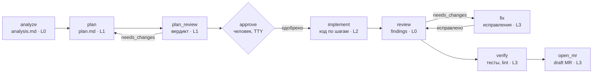

# plait — продуктовый бриф

5 ноября 2026 · Aleksandr Shatrov

## Суть

**plait** — CLI на Go, которой пользуются не люди, а coding-агенты: Claude Code, Codex, Gemini CLI, Qwen Code, pi. Она ведёт агента по dev-flow команды (задача → при необходимости анализ и план → реализация → ревью → MR/PR), хранит артефакты задачи в репозитории и проверяет обращения агента по политике репозитория. Что plait гарантирует, а что нет, — в разделе «Границы гарантий».

Название от англ. *plait* — «сплетать»: утилита сплетает разных агентов и людей в один процесс.

**Проблема.** Разработчики в команде пользуются разными агентами, каждый по-своему и только как помощником. Общего процесса, общих артефактов и способа постепенно доверять агентам больше нет. Нужен инструмент, который даёт одинаковый управляемый flow в любом агенте и вводит автономию ступенями.

**Как это работает.** Разработчик работает в своём агенте как обычно и вызывает skill, например `/plait-review`. Агент спрашивает у `plait`, что делать дальше (`plait next`), выполняет шаг и сохраняет результат через `plait`. Логика процесса, проверки и гейты живут в детерминированном Go-бинаре, а не в промпте.

**Распространение.** Open source на GitHub под MIT. Корпоративное зеркало в self-hosted GitLab живёт без патчей кода, только с конфигом.

## Цели и контекст

Главная цель — дать команде единый управляемый flow работы с агентами, от анализа задачи до MR, в любом агенте. Внедрение должно быть быстрым: установка одной командой и короткая обкатка, а не отдельная программа.

Обычно агенты в команде только помогают: объясняют код и пишут фрагменты. Целевая среда включает закрытый корпоративный контур: прокси, внутренний реестр артефактов, self-hosted GitLab, требования безопасности.

Цели:

1. Дать один и тот же процесс во всех агентах, которыми пользуется команда. Пересаживать всех на один агент не требуется.
2. Дать тимлиду контроль над тем, какие стадии агенту разрешены в репозитории. Это настройка политики автономии, а не поэтапная программа внедрения.
3. Сделать работу агента прозрачной: планы и ревью лежат в репозитории и в MR, для каждого run ведётся аудит-журнал.
4. Работать в закрытом корпоративном контуре без доработок: один статический бинарь, без телеметрии, с внутренними endpoint'ами моделей.
5. Поставляться как open source.

Не цели: заменить агентов собственным; сделать GUI или канбан; автономно вести задачи без человека в цикле.

## Первая версия (v0)

**Обещание:** помогает довести изменения до MR и продолжить работу после смены сессии — с одним агентом. Второй агент углубляет ревью; это гипотеза до замера, а не гарантия. Доступ ко второму агенту есть не у всех, поэтому польза с одним агентом — условие, а не бонус. v0 оценивается по разработчику: если он не вызывает `/plait-review`, тимлиду контролировать нечего.

Маршрут v0: `ctx` → работа как обычно (`analyze`/`plan` по желанию) → `review` → `mr describe`.

- **`ctx`** — общий вход: агент работает от критериев приёмки, а не от пересказа, ревью проверяет против них.
- **`review`** — точка входа. Пакет ревью: задача и критерии, правила репо, точный снимок диффа, результаты доступных проверок. Ревьюер в свежей сессии получает критерии и код, а не рассуждения автора. В v0 свежая сессия открывается вручную по пакету, результат импортируется обратно; автоматический запуск появляется с headless-адаптерами. Ручной режим не даёт технической гарантии read-only.
- Ревью привязано к снимку диффа. Повторный прогон сравнивает находки с прошлым: что исправлено, что ждёт решения, что после правок требует перепроверки.
- Отчёт помечен «проверено по критериям задачи» или «проверен только дифф» — иначе разработчик получит ложную уверенность в соответствии требованиям.
- Находки нескольких ревьюеров сводятся в один список: без повторов, с серьёзностью и основанием, с видимыми разногласиями. Совпадение двух моделей не повышает истинность, важная одиночная находка не теряется.
- **`mr describe`** собирает описание из тех же данных. Создание MR в v0 не входит.

Сохранять файлы и готовить MR умеет и skill с шаблоном. plait добавляет детерминированный снимок диффа и сравнение находок между прогонами. Если это не экономит время относительно простого skill, упрощаем продукт, а не добавляем стадии.

## Границы гарантий

plait — помощник процесса, а не принуждение. Он контролирует только то, что идёт через него: агент может править код, не вызывая plait, а политика автономии проверяется, лишь когда агент обращается к утилите.

- Локальный plait подтверждает собственную оценку готовности: какие артефакты есть, к какому снимку диффа относится ревью, какие проверки пройдены.
- Обязательность для слияния даёт только отдельный гейт в forge/CI, который проверяет, что ревью относится к актуальному диффу и действующим правилам. В v0 его нет.
- Даже такой гейт подтверждает проведённые проверки, но не доказывает, кто писал код.
- Deny-правила, которые ставит `setup`, сужают обход, но не исключают его.

## Принципы продукта

- **Агент — пользователь, человек — надзирающий.** Команды и вывод спроектированы под агента. Человек запускает утилиту сам только для `setup`, `init`, `approve`, `status`.
- **Внутри сессии агента, а не снаружи.** Основной режим: разработчик в своём агенте, агент вызывает `plait`. Headless-запуск других агентов — вспомогательная функция, например для cross-agent review.
- **Детерминизм.** Переходы между стадиями, проверки артефактов и права решает Go-код. LLM не управляет процессом.
- **Состояние — в файлах репозитория.** Run можно продолжить в другой сессии и другим агентом. Планы и ревью попадают в MR.
- **Агенто-нейтральность.** Равная поддержка Claude Code, Codex, Gemini CLI, Qwen Code и pi. Никаких функций, доступных только в одном агенте, в базовом сценарии.
- **Тонкие skills, толстый бинарь.** Инструкции стадий и шаблоны вшиты в бинарь, поэтому skills и версия утилиты не расходятся.
- **Конфиг вместо патчей.** Всё, что отличает корпоративную установку, задаётся конфигом, оверлеем промптов и хуками.
- **Local-first.** Никакой телеметрии и сетевых вызовов, кроме явно настроенных (GitLab/GitHub API).

## Пользователи и сценарии

| Кто | Что делает с plait | Через что |
| --- | --- | --- |
| Агент (основной пользователь) | Узнаёт следующий шаг, получает инструкции и контекст, сохраняет и валидирует артефакты, просит ревью у другого агента, создаёт MR | skills + `plait next/guide/...` с JSON-выводом |
| Разработчик | Вызывает стадию в своём агенте, подтверждает гейты, смотрит статус run | `/plait-*` в агенте, `plait approve`, `plait status` |
| Тимлид | Подключает репозиторий, задаёт политику автономии и промпты команды, смотрит статистику | `plait init`, `.plait/config.yaml`, `plait stats` |

Ключевые сценарии по приоритету:

1. **Ревью готового диффа перед MR** по критериям задачи и правилам репозитория, с одним агентом. Второй агент — опциональное усиление.
2. **Описание MR/PR** из диффа и артефактов run.
3. **Контекст задачи из Jira**, анализ и брейншторм → дизайн-заметка, когда задача неоднозначна.
4. **План и его ревью другим агентом.** Реализует либо человек, либо агент.
5. **Полный цикл:** реализация по плану → ревью → исправления → draft MR.

## Маршруты и политика автономии

Это две независимые настройки: **маршрут** определяет, какие артефакты нужны изменению, **автономия** — какие действия разрешены агенту.

Маршруты:

- **короткий:** `review` → проверки → `mr describe`;
- **плановый:** `analyze` → `plan` → `plan_review` → реализация → `review` → проверки → `mr describe`.

Критерии короткого маршрута задаёт тимлид в конфиге: виды изменений, защищённые пути. plait не притворяется классификатором риска, и малый дифф — не признак низкого риска. При неопределённости маршрут выбирает разработчик, а не агент. Стадии вне маршрута получают статус `not_required`, а не approved. Исключение из обязательного маршрута фиксируется с причиной и подтверждением человека; обычный короткий маршрут исключением не считается и `approve` не требует. Обязательные проверки команды входят в оба маршрута. Изменился дифф — ревью помечается устаревшим; изменился класс изменения — маршрут пересчитывается.

Уровень автономии задаётся полем `autonomy` в `.plait/config.yaml`. Он определяет, какие стадии доступны агенту, и проверяется утилитой: на уровне 1 `plait stage start implement` вернёт отказ с объяснением. По умолчанию стоит уровень 3, весь flow.

| Уровень | Агент | Человек | Стадии |
| --- | --- | --- | --- |
| 0 · Ассистент | Анализ, ревью чужого диффа, описание MR | Пишет весь код | `analyze`, `review`, `mr describe` |
| 1 · Планировщик | + план и его ревью | Реализует по плану | + `plan`, `plan_review` |
| 2 · Исполнитель | + реализация по шагам | Подтверждает каждый шаг | + `implement --step` |
| 3 · Цикл | + цикл ревью/исправлений | Ревьюит MR | + `implement`, `fix` |

Уровень можно переопределить для части путей (`autonomy_overrides`), например держать код с повышенными требованиями (например, платёжный или персональных данных) на уровне ≤1. Скиллы стадий выше допустимого уровня не устанавливаются в проект.

Создание MR — отдельное разрешение `forge.create_mr: off|draft`, не привязанное к уровню: право открыть draft MR и право писать код дают разные последствия.

## Flow и стадии



Агент узнаёт стадию из `plait next` и сдаёт результат через `save`, а переход делает plait. Ревью плана и кода повторяются до вердикта approved, число итераций ограничено, а при повторе тех же замечаний решение передаётся человеку. L0–L3 — минимальный уровень автономии для стадии. Любую стадию можно запустить отдельно: например, только `review` для кода, написанного человеком.

Артефакты run лежат в `.plait/runs/<run-id>/`: `task.md`, `analysis.md`, `plan.md`, `review-*.json`, `state.json`, `messages.jsonl`, `audit.jsonl`.

## Интерфейс CLI для агентов

Центр интерфейса — команда `plait next`. Она возвращает текущую стадию, инструкцию, разрешённые команды и путь к артефакту, поэтому агенту не нужно помнить процесс.

```json
{
  "run": "2026-11-05-order-retry",
  "stage": "plan_review",
  "autonomy": 1,
  "do": "Проверь план по чек-листу из `plait guide plan_review`, сохрани вердикт.",
  "inputs": [".plait/runs/2026-11-05-order-retry/plan.md"],
  "output": {"cmd": "plait review save --stage plan_review", "schema": "review-verdict/v1"},
  "allowed": ["guide", "review save", "review --with", "status"],
  "gate": "human"
}
```

Команды:

| Группа | Команды | Кто вызывает |
| --- | --- | --- |
| Установка | `setup`, `init`, `doctor`, `version` | человек |
| Навигация | `next`, `guide <stage>`, `status`, `run new/resume/list` | агент |
| Контекст задачи | `ctx <JIRA-KEY>`, `ctx save <JIRA-KEY>` | агент |
| Артефакты | `analyze save`, `plan new/check/save`, `review collect/save`, `verify` | агент |
| Другие агенты | `review --with <agent>`, `ask <role>`, `msg send/inbox`, `wait <job>` | агент |
| Очередь | `worker` (выполняет задания из песочницы) | человек, вне песочницы |
| Гейты | `approve`, `reject` | только человек (TTY) |
| MR/PR | `mr describe`, `mr create` | агент |
| Статистика | `stats`, `log` | человек |

Правила контракта:

- Вывод в JSON, если вывод идёт не в TTY или указан `--json`. Схемы версионируются (`review-verdict/v1`).
- Осмысленные exit codes: 0 — ок, 2 — ошибка валидации артефакта, 3 — запрещено политикой, 4 — нужен человек.
- Ошибки сформулированы как инструкция агенту: «в плане нет раздела «Риски»; добавь его и вызови `plait plan check`».
- Команды идемпотентны и никогда не задают вопросов в неинтерактивном режиме.
- `approve`/`reject` требуют интерактивный TTY и ввод подтверждения. Bash-инструменты агентов работают без TTY, так что агент не может одобрить сам себя. `setup` дополнительно прописывает deny-правила там, где агент их поддерживает (Claude Code: `Bash(plait approve:*)`).

## Skills и поставка в агентов

Все пять целевых агентов поддерживают формат Agent Skills (папка с `SKILL.md`), отличаются только пути. Skills вшиты в бинарь (`go:embed`), поэтому для установки не нужны ни npx, ни сеть.

| Агент | В проекте | У пользователя | Контекст-файл |
| --- | --- | --- | --- |
| Claude Code | `.claude/skills/` | `~/.claude/skills/` | `CLAUDE.md` |
| Codex | `.agents/skills/` | `~/.codex/skills/` | `AGENTS.md` |
| Gemini CLI | `.gemini/skills/` или `.agents/skills/` | `~/.gemini/skills/` | `GEMINI.md` |
| Qwen Code | `.qwen/skills/` | `~/.qwen/skills/` | `QWEN.md` |
| pi | `.pi/skills/` | `~/.pi/agent/skills/` | `AGENTS.md` |

Пути взяты из таблицы [vercel-labs/skills](https://github.com/vercel-labs/skills/wiki) и [документации Gemini CLI](https://geminicli.com/docs/cli/creating-skills/). Адаптер установки проверяет их на каждой версии агента.

**Производные агенты.** В организации могут использоваться форки агентов или обёртки, которые запускают агента в песочнице. Их описывают в system-конфиге `/etc/plait/config.yaml`; апстрим про них не знает и даёт механизм наследования адаптеров:

```yaml
agents:
  qwen-fork:
    base: qwen              # флаги, формат вывода, MCP — как у Qwen Code
    cmd: qwen-fork
    skill_dirs: { project: .qwen-fork/skills }
  claude-sandboxed:
    base: claude
    cmd: <обёртка>          # стартует claude в песочнице
    args_passthrough: true  # -p, --output-format и др. пробрасываются в claude
    sandboxed: true         # MCP только из allowlist, запуск других агентов запрещён
```

Такая песочница может не давать подключаться к loopback-MCP и запускать других агентов, а MCP-серверы доступны только из разрешённого списка. Для `sandboxed: true` plait работает так:

1. Общение агентов идёт через CLI-транспорт (`plait ask/msg`), встроенный MCP-сервер не используется.
2. `review --with`, `ask_agent` и режимы debate/council ставят задание в очередь `.plait/queue/`. Выполняет его `plait worker`, запущенный разработчиком вне песочницы, а агент ждёт результат через `plait wait <job>`. Если worker не запущен, `next` предлагает ревью тем же агентом в свежей сессии.
3. `doctor` проверяет, что `plait` вызывается изнутри песочницы и что `.plait/` доступна на запись.

Если MCP-сервер plait нельзя добавить в allowlist песочницы, CLI-транспорт и очередь — постоянный режим работы, а не временный обход.

**Набор skills:** общий `plait` (flow, правила, «сначала `plait next`») и по одному на стадию: `plait-analyze`, `plait-plan`, `plait-implement`, `plait-review`, `plait-mr`.

**Формат skill:** 20–40 строк, узкий `description` («используй, когда пользователь явно попросил /plait-…»), версия в frontmatter. В Claude Code — `disable-model-invocation: true` (только явный вызов). Подробные инструкции агент получает из `plait guide <stage>`.

**Команды установки:**

- `plait setup` — разработчик, один раз. Находит установленных агентов, ставит skills в user-scope, прописывает правила разрешений, запускает `doctor`. Флаги: `--agent`, `--scope user|project`, `--dry-run`, `--uninstall`.
- `plait init` — тимлид, один раз на репо. Создаёт `.plait/config.yaml`, project-skills в `.agents/skills/` и `.claude/skills/`, секцию в `AGENTS.md` с импортом в `CLAUDE.md`/`GEMINI.md`.
- `plait doctor` — версии агентов, совпадение версий skills и бинаря, прокси/CA, доступность endpoint'ов и GitLab/GitHub API.

## Взаимодействие агентов

Агенты не говорят напрямую: все сообщения идут через plait. Поэтому переходы детерминированы, права проверяет Go-код, а вся переписка попадает в аудит-журнал run.

**Роль** = агент + закреплённая сессия + права. Примеры: `planner`, `implementer`, `rev-codex`. Сессия сохраняется в `state.json`, поэтому роль отвечает с полным контекстом своей стадии.

Механизмы в порядке реализации:

1. **Cross-agent review.** `plait review --with codex` из сессии любого агента запускает другого агента в headless-режиме и только на чтение. Вердикт возвращается по JSON Schema.
2. **Режимы, которые ведёт plait.** `debate`: автор плана и ревьюер обмениваются репликами до N раундов через resume сессий. `council`: во втором раунде ревьюеры видят находки друг друга и подтверждают или отклоняют их.
3. **Встроенный MCP-сервер на время run.** Streamable HTTP на `127.0.0.1:<random>` с bearer-токеном. Инструменты: `ask_agent(role, question)` — синхронный вопрос через resume сессии роли; `send_message`/`read_inbox`; `post_finding`/`list_findings`; `reserve_paths`/`release_paths`. Те же операции доступны через CLI (`plait ask`, `plait msg`) для агентов без MCP и для песочниц, где loopback-MCP недоступен. Все пять агентов поддерживают MCP, pi — начиная с 1.0 (mcp.json, stdio и streamable HTTP).
4. **Человек как участник.** `plait say @implementer "…"` и `plait tail` для наблюдения за перепиской.

Ограничения:

- Сообщения других агентов — недоверенные данные, а не инструкции. Права проверяются по `mode` и `can_ask` роли.
- Лимиты: `max_messages_per_stage`, `max_ask_depth: 1` (без дедлоков), `ask_timeout`, бюджет токенов на роль, детектор зацикливания.
- При параллельной реализации — отдельный worktree на исполнителя и pre-commit hook на чужие зарезервированные пути.
- A2A не используем, пока не появится внешний потребитель. ACP — опциональный транспорт для адаптера «любого другого агента».

## Архитектура

Один статический Go-бинарь без CGO. В нём state machine стадий, адаптеры агентов, forge-клиенты, встроенные skills и промпты.

```
cmd/plait/main.go
internal/
  cli/        # cobra: setup init doctor next guide status run plan review approve mr stats ...
  config/     # koanf: embed defaults → /etc/plait → ~/.config/plait → .plait/config.yaml → env → flags
  pipeline/   # state machine, Stage, Gate, Run, policy (autonomy), state.json
  artifact/   # шаблоны и валидаторы plan/review/analysis, JSON Schema
  agent/      # интерфейс Agent + registry
    claude/ codex/ gemini/ qwen/ pi/ generic/ acp/
  install/    # установка skills и permission-правил по агентам
  skills/     # embed.FS: SKILL.md + guide-тексты стадий
  prompt/     # text/template, embed + overlay (.plait/prompts, ~/.config/plait/prompts)
  bus/        # сообщения между ролями: messages.jsonl → позже modernc.org/sqlite
  mcpsrv/     # MCP-сервер run (modelcontextprotocol/go-sdk)
  vcs/        # git: diff, branch, worktree, commit (exec git)
  forge/      # Forge: gitlab/ (client-go/v2), github/ (go-github), cli/ (glab/gh)
  tracker/    # Tracker: jira/ (mcp — через агента | rest — PAT) для plait ctx
  audit/      # аудит-журнал, redaction, usage.jsonl
  ui/         # huh/lipgloss для approve/status; --no-tui
```

Ключевые интерфейсы:

```go
type Agent interface {
    Name() string
    Detect(ctx context.Context) (Installed, error) // версия, пути skills
    Capabilities() Caps                            // StructuredOutput, Resume, ReadOnly, MCP, Cost
    Run(ctx context.Context, req Request) (*Result, error) // headless: review --with, ask, debate
}

type Installer interface { // отдельно от Run: ставит skills и правила
    SkillDirs(scope Scope) []string
    InstallSkills(scope Scope, fs fs.FS) error
    InstallPermissions(scope Scope, rules []Rule) error
}

type Stage interface {
    ID() StageID
    MinAutonomy() int
    Next(rc *RunContext) (Instruction, error)   // что отдать в `plait next`
    Accept(rc *RunContext, a Artifact) (Outcome, error) // валидация + переход
}

type Role struct {
    ID, Agent, SessionID string
    Mode   Mode     // ReadOnly | EditWorkspace
    CanAsk []string
}

type Forge interface {
    Detect(remoteURL string) bool
    OpenChangeRequest(ctx context.Context, cr ChangeRequest) (url string, err error)
}
```

`Mode` преобразуется в флаги агента внутри адаптера. ReadOnly → `--permission-mode plan` / `--sandbox read-only` / `--approval-mode plan`. Так ограничение ревьюера обеспечивает сам агент, а не промпт.

Конфиг репозитория:

```yaml
autonomy: 3
autonomy_overrides:
  - paths: ["internal/payments/**"]
    max: 1
routes:
  default: short
  planned_when: { paths: ["internal/payments/**", "migrations/**"] }
forge: { create_mr: draft }
agents:
  claude: { cmd: claude, env: { ANTHROPIC_BASE_URL: "${LLM_GW}/anthropic" } }
  codex:  { cmd: codex, profile: corp }
  qwen:   { cmd: qwen, env: { OPENAI_BASE_URL: "${LLM_GW}/v1" } }
roles:
  planner:   { agent: any, mode: read_only }
  rev-codex: { agent: codex, mode: read_only }
stages:
  review:      { reviewers: [rev-codex], mode: council }
  plan_review: { reviewers: [rev-codex], mode: debate, rounds: 3 }
  verify:      { commands: ["go test ./...", "golangci-lint run"] }
  open_mr:     { draft: true, labels: [ai-assisted] }
artifacts:
  dir: .plait/runs
  publish_plans_to: docs/plans   # планы попадают в MR
comms: { transport: mcp, max_ask_depth: 1, max_messages_per_stage: 30 }
audit: { redact: true, deny_globs: [".env*", "**/*.pem", "**/secrets/**"] }
```

Библиотеки: `spf13/cobra`, `knadh/koanf`, `charmbracelet/huh` + `lipgloss`, `log/slog`, `gitlab.com/gitlab-org/api/client-go/v2`, `google/go-github`, `modelcontextprotocol/go-sdk`, `zalando/go-keyring`. Процессы агентов запускаются через `exec.CommandContext` в отдельной process group.

## Jira и MR/PR

По умолчанию MR/PR создаётся через API, а не через CLI-обёртки. GitLab — через `gitlab.com/gitlab-org/api/client-go/v2` (преемник `xanzy/go-gitlab`), GitHub — через `google/go-github`. Так не нужны установленные `glab`/`gh`, а прокси и CA задаются в одном месте. Режим `forge: cli` — запасной.

- **Автоопределение хостинга** по `git remote get-url origin`. `github.com` → GitHub. Хост из `forges.gitlab.hosts` → GitLab. Иначе проба `GET /api/v4/version`. Для SSH-remote base URL API берётся из конфига.
- **Токены:** env (`GITLAB_TOKEN`, `GITHUB_TOKEN`) → хранилище `glab`/`gh` → OS keyring. В конфиг-файлах токенов нет.
- **Транспорт:** `http.ProxyFromEnvironment` + корпоративный CA из конфига или `SSL_CERT_FILE`.
- **Тело MR собирается из артефактов:** резюме плана, ссылка на `docs/plans/...`, итоги ревью, чек-лист verify, метка `ai-assisted`. По умолчанию создаётся draft.
- **`mr describe`** только генерирует описание и ничего не создаёт, поэтому доступен на любом уровне автономии.

**Jira — `plait ctx <KEY>`.** Jira — штатный источник задачи, но её недоступность не блокирует run: задачу можно передать локальным описанием через `plait ctx save` или импортом через агента. Источник записывается в `task.md`.

- **Два режима, `jira.mode: mcp|rest`.** В v0 — только импорт через агента, REST-клиент не входит в её условия. `mcp` — для сред, где Jira доступна агентам через разрешённый MCP-сервер. `plait ctx PROJ-123` возвращает агенту инструкцию получить задачу этим MCP и сохранить её через `plait ctx save PROJ-123` (JSON или Markdown на stdin). Имя инструмента задаётся в `jira.mcp_tool` и подставляется в инструкцию. Сам plait в Jira не ходит, отдельный токен не нужен.
- **`rest`** — для апстрима и окружений без MCP: Jira REST API (Server/DC или Cloud), PAT из `JIRA_TOKEN` или keyring, транспорт общий с forge.
- В обоих режимах задача нормализуется в `.plait/runs/<id>/task.md`: summary, описание, критерии приёмки, комментарии, связанные задачи. Этот файл — вход для `analyze` и `review`.
- Если критериев приёмки нет или они неоднозначны, `task.md` фиксирует пробел явно: нормализация его не заполняет. Если от пробела зависит реализация, `next` требует уточнения у человека (exit 4).
- Ключ задаёт имя run и ветки (`PROJ-123-<slug>`) и попадает в сообщения коммитов. **Заголовок MR по умолчанию начинается с ключа** (`PROJ-123: <summary>`): по нему интеграция GitLab/Jira привязывает MR к задаче. Шаблоны задаются в конфиге, `mr create` проверяет префикс.
- Jira только читается, обратная запись не нужна.
- Интерфейс `Tracker` сделан по аналогии с `Forge`, чтобы позже добавить GitLab/GitHub issues.

## Безопасность и закрытый контур

Утилита сама не делает никаких сетевых вызовов, кроме GitLab/GitHub API, и не даёт агентам, которых запускает, уйти за пределы allow-list.

- **Без телеметрии и update-check.** Агентам, которых запускает plait, выставляются `DISABLE_TELEMETRY=1` и аналоги. Статистика только локальная; OTLP — лишь на свой endpoint и по явному включению.
- **Allow-list endpoint'ов.** Перед headless-запуском агента plait проверяет, что `*_BASE_URL` указывают на разрешённые хосты, иначе отказывает. `doctor` показывает нарушения и для интерактивных агентов.
- **Аудит-журнал run:** кто, когда, какой агент и модель, хеш промпта, список файлов в контексте, вердикты, кто одобрил гейт, переписка агентов.
- **Redaction и deny-globs.** В промпты и логи не попадают `.env`, ключи, секреты и дампы. Сканер на PAN-подобные последовательности (Luhn) блокирует артефакты и сообщения с карточными данными.
- **Хуки стадий** `pre_stage`/`post_stage` — внешние команды, например внутренний SAST или проверка на секреты. Это точка расширения для корпоративных установок без патчей.
- **Разделение прав.** Ревьюеры всегда работают только на чтение, гейты одобряет только человек, автономия ограничена по путям.
- **Внутренние модели.** Claude Code — `ANTHROPIC_BASE_URL`, Codex — `model_providers` через `--profile`/`-c` (project-level `.codex/config.toml` не переопределяет провайдера), Qwen Code — `OPENAI_BASE_URL`, pi — провайдер в настройках. Gemini CLI во внутреннем контуре наименее гибок.

## Распространение и форк

**Пока основной путь — сборка из исходников:** `make build` / `go build ./cmd/plait` или `go install`. GoReleaser, пакеты и проверка занятости имени в реестрах отложены до публичных релизов. Требования к сборке: только Go toolchain, без CGO и без генерации кода с доступом в сеть, зависимости тянутся через `GOPROXY` (в закрытом контуре — Artifactory или аналог). Версия вшивается через `-ldflags` из `git describe`, она же попадает во frontmatter skills.

**GitHub (апстрим, MIT).** Релизы собирает GoReleaser v2: кросс-сборка, `checksums.txt`, SBOM, подпись cosign keyless, deb/rpm через nfpms, Homebrew через `homebrew_casks` (секция `brews` устарела). Доступна установка `go install github.com/<owner>/plait/cmd/plait@latest`. Код из AGPL-проектов не заимствуем.

**Корпоративное зеркало — «форк без патчей».**

- Pull mirroring с GitHub, если исходящий доступ разрешён, иначе `git fetch upstream` через прокси.
- Module path не меняется (`github.com/<owner>/plait`). Сборка идёт через Artifactory как `GOPROXY`, внутренние пути — в `GOPRIVATE`/`GONOSUMDB`.
- Бинарь распространяется через releases внутреннего GitLab или generic-репозиторий Artifactory.
- Всё специфичное для организации — данные, а не код: `/etc/plait/config.yaml` (system layer с endpoint'ами, allow-list, forge-хостами), оверлей промптов, хуки стадий, `generic`-адаптер агента в YAML. Цель — ноль диффов в `internal/`.
- В README есть раздел «Enterprise / air-gapped»: офлайн-установка, корпоративный CA, внутренние endpoint'ы.

## Аналоги и позиционирование

Ниша плотная, ближайший аналог — Trellis ([разбор аналогов](research/README.md)). По полному roadmap plait отличается сочетанием трёх вещей: детерминированный Go-бинарь с гейтами и политикой автономии; GitLab self-hosted наравне с GitHub; закрытый корпоративный контур (прокси, внутренние модели, аудит, без Node/Python). В v0 этого нет, и отличие v0 уже: ревью привязано к снимку диффа, находки сравниваются между прогонами, описание MR собирается из них.

| Инструмент | Что делает | Что взять | Чем plait отличается |
| --- | --- | --- | --- |
| [Trellis](https://docs.trytrellis.app/start/install-and-first-task) | Командный harness: specs, tasks, workflow в `.trellis/`, адаптеры для 20+ агентов, ревью Claude/Codex в отдельной сессии (`trellis channel`) | Генерация файлов под каждого агента, `.agents/skills` как общий слой, A/B через `ablate`/`restore` | Node + Python, AGPL; нет детерминированных гейтов, снимка диффа, сравнения находок между прогонами и описания MR |
| [Superpowers](https://github.com/obra/superpowers) | Skills: brainstorming → plans → execution → review | Промпты брейншторма, формат плана | Один агент, нет состояния и политики |
| [OpenSpec](https://github.com/Fission-AI/OpenSpec) / Spec Kit | Spec-driven команды внутри агента | Структура `changes/<id>/`, архив изменений | Не создаёт MR, нет ревью другим агентом |
| [quorum-ai](https://github.com/hugo-lorenzo-mato/quorum-ai) | Go-оркестратор нескольких агентов: консенсус по анализу задачи, PR в GitHub | Взвешенные расхождения для этапа 2, trace-манифест прогона; MIT | Внешний оркестратор, а не инструмент внутри сессии; ревью диффа и GitLab нет |
| [relay](https://github.com/aydinmrnv/relay), [foreman](https://github.com/josh-melton-db/foreman) | План → ревью → реализация → ревью → PR, cross-vendor review | Модель cross-agent review | GitHub-центричны |
| [MCP Agent Mail](https://pypi.org/project/mcp-agent-mail/) | Inbox/outbox, file leases для агентов через MCP | Модель сообщений и блокировок | Встроено в один бинарь, без демона; лицензия у них не чистый MIT |
| Claude Code Agent Teams | Mailbox и общий список задач между сессиями Claude | Идею mailbox на файлах | Только Claude, экспериментально |
| [Waymark](https://dev.to/shaifulshabuj29/waymark-the-control-layer-your-ai-coding-agent-was-missing-1ch6) | Политики и approval для действий агента | Идею approval-очереди | plait управляет стадиями, а не отдельными файловыми операциями |

## Roadmap

Первая поставка проверяет гипотезу v0; всё после неё — только после замера. Объём этапов и условия продолжения — в `docs/development-plan.md`.

1. **v0: ревью и описание MR с одним агентом.** cobra + koanf, `version`, `doctor`, `setup`/`init` для двух пилотных агентов с наследуемыми адаптерами (`base:`), `next --json`, `state.json`, аудит-журнал, `make build`. `ctx` (импорт через агента, локальное описание), `review collect/save` со снимком диффа, схемой находок и сравнением прогонов, ревью тем же агентом в свежей сессии через ручной пакет, импорт/экспорт ревью, `mr describe`. Минимум закрытого контура: прокси, корпоративный CA, внутренние endpoint'ы моделей, без телеметрии.
2. **Второе мнение.** Headless-адаптеры двух пилотных агентов с проверенным read-only (остальные помечены experimental), автоматическая свежая сессия, `review --with` и сведённый отчёт, `plait worker` на одно задание для песочниц, где запуск агентов запрещён. Skills для остальных трёх агентов.
3. **Маршруты и MR.** `routes` в конфиге, `analyze`, `plan new/check/save`, `plan_review`, гейт `approve` через TTY, публикация плана в `docs/plans`, `mr create` по разрешению `forge.create_mr` для GitLab (client-go), затем GitHub, `ctx` в режиме `rest`.
4. **Реализация и цикл.** `implement --step`, `fix` с лимитом итераций и детектором стагнации, `verify`, worktree, политика автономии по путям.
5. **Общение агентов.** `debate`/`council`, встроенный MCP-сервер (`ask_agent`, `send_message`/`read_inbox`), CLI-дубль, очередь общего назначения, `say`/`tail`, findings board и leases.
6. **Enterprise.** System-конфиг, оверлей промптов, хуки, allow-list, PAN-сканер, `stats`, CI-гейт для MR, инструкция по корпоративному зеркалу.
7. **Потом:** GoReleaser и публичные релизы, ACP-адаптер, контейнерный режим исполнения, A2A — только при появлении спроса.

## Запуск и проверка гипотезы

Запуск в команде: тимлид делает `plait init` в репозитории, каждый разработчик ставит бинарь и делает `plait setup`. Дальше — короткая обкатка на реальных задачах и правка промптов в оверлее репо.

**Гипотеза v0:** с plait разработчик быстрее доводит задачу до MR, а человек тратит меньше усилий на проверку при том же качестве. Польза второй модели — отдельная гипотеза.

**Замер до расширения.** Два замера на нескольких одинаковых диффах одного типа задач. После v0 — обычный `/review` в агенте против plait-ревью тем же агентом в свежей сессии. После этапа 2 — свежая сессия той же модели против `review --with`. Первый замер не ждёт второго. Считаем время до готового MR, находки, подтверждённые человеком, объём доработок на человеческом ревью, стоимость и ожидание. Подтверждение — короткий вердикт человека на выборке в обычном разборе MR, без нового интерфейса. Больше находок — не выигрыш, если растёт время разбора или находки малозначимы. Если выигрыш только в единообразии артефактов, это ценность для тимлида, и её проверяем отдельно.

`plait stats` считает по аудит-журналу вспомогательные сигналы, а не подтверждение качества:

- изменился ли связанный участок после находки — правка может быть неверной или по другой причине, а отсутствие правки не значит, что находку отклонили;
- итерации ревью → исправление;
- токены и стоимость по стадиям и агентам;
- доля MR через plait — охват, а не польза.

## Риски

| Риск | Что делаем |
| --- | --- |
| Флаги и пути агентов быстро меняются | Проверка версии в каждом адаптере, интеграционные тесты на JSONL-фикстурах, `doctor` |
| Агент игнорирует skill или перепрыгивает стадии | Стадии принимаются только через `save`/`check`; обязательность — только CI-гейтом (см. «Границы гарантий») |
| Агент обходит гейт | `approve` только через TTY, deny-правила в агентах, аудит |
| Prompt injection между агентами | Сообщения — данные, права проверяет Go-код |
| Карточные данные и секреты в контексте | Deny-globs, redaction, PAN-сканер |
| Конкурент закроет нишу | Trellis и quorum-ai разобраны ([вывод](research/README.md)); Trellis ближе всего, следить за `trellis channel`; фокус на GitLab + enterprise |
| Процесс измеряет собственное прохождение вместо пользы | Гипотеза и замер против обычного `/review` до расширения; `stats` — только вспомогательные сигналы |
| Полный flow на мелкой задаче — накладные расходы, разработчик бросает plait | Короткий маршрут по умолчанию, `analyze`/`plan` по необходимости |
